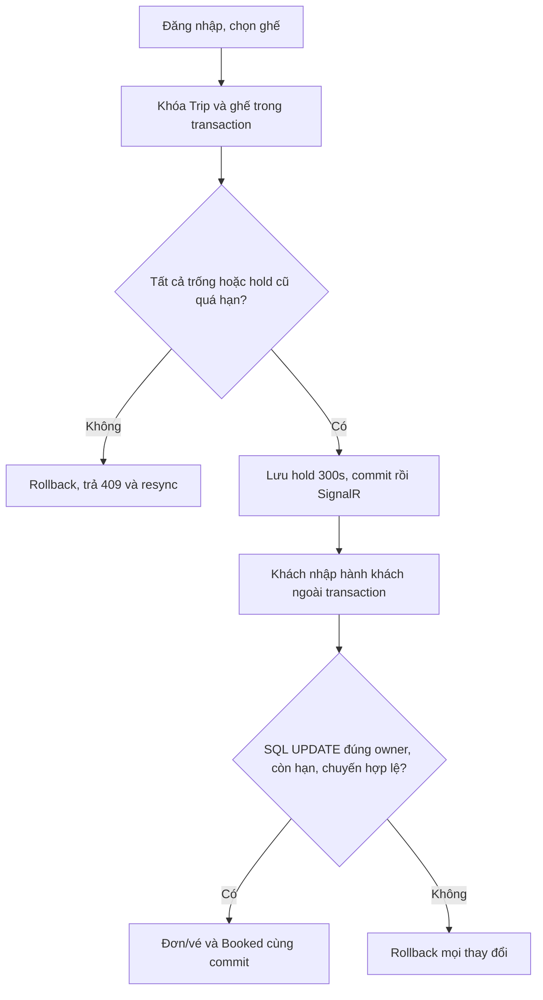
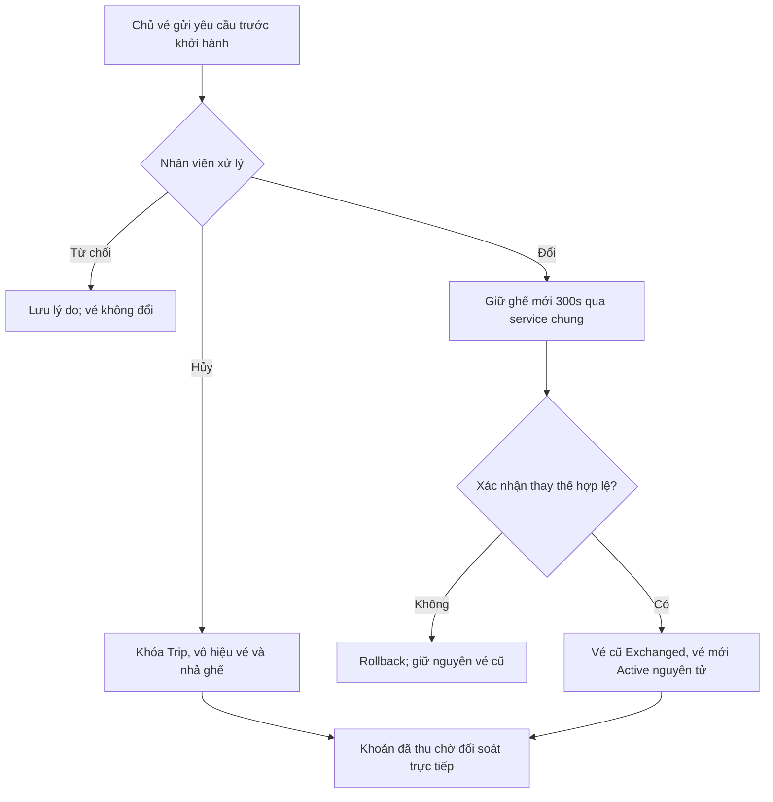

# Activity: giữ và xác nhận

## Hủy / đổi

Worker: quét index theo batch → khóa Trip → kiểm hạn SQL lại → chỉ nhả đúng CurrentHold Active quá hạn → commit → invalidation. Restart không khởi tạo lại hạn.
