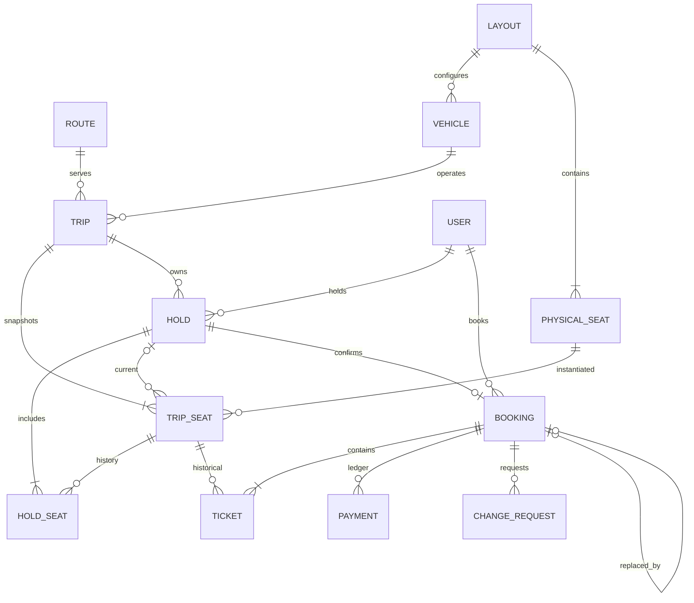

## Bổ sung độc lập: ContactMessages

Migration AddContactMessages thêm một bảng, không thay quan hệ hiện có. Id là Guid PK; SubmissionKey có unique index chống ghi trùng; FullName/Email/Phone tùy chọn/Subject/Body/CreatedUtc/IsRead phục vụ tiếp nhận liên hệ. Không FK đến người dùng hoặc booking, để Guest gửi và giữ nguyên mô hình đặt vé. Các thực thể, ràng buộc và sơ đồ nghiệp vụ cũ phía dưới giữ nguyên.

---

# ERD

Cardinality Ticket nhiều trong lịch sử của TripSeat, nhưng unique filtered chỉ cho một IsActive=1. Một TripSeat chỉ trỏ tối đa một CurrentHold. Danh sách người giữ/hành khách không xuất qua snapshot công khai. Bốn roles dùng Identity UserRoles; DriverId/StaffId là FK User trên Trip, phân công kiểm role ở service. Xem DATABASE_DESIGN.md cho khóa kép và chỉ mục.

## Quan hệ tăng thêm (không thay các quan hệ cũ)

| Cha | Con / liên kết | Quy tắc |
|---|---|---|
| Trips | TripStops.TripId | 1-n, Restrict; unique TripId + StopOrder |
| TripStops | SeatHolds.PickupStopId / DropoffStopId | Nullable cho hold cũ, owner validation và cùng TripId ở service |
| TripStops | Bookings.PickupStopId / DropoffStopId | Nullable cho vé cũ, Restrict; booking có snapshot bất biến |

Không thêm TripId khác vào Ticket; tiếp tục suy ra qua TripSeat.
