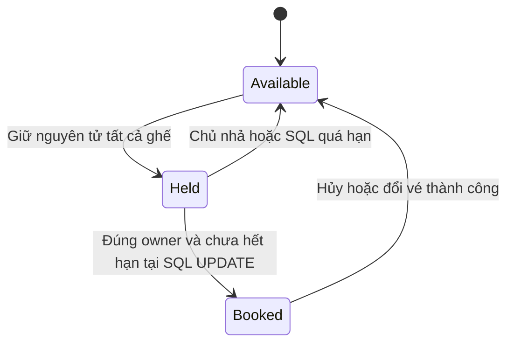

# Trạng thái ghế / hold / vé / tiền

| Vòng đời | Trạng thái | Điều kiện |
|---|---|---|
| Hold | Active → Released | Chủ nhả; hoặc đóng bán/đổi trạng thái/hủy chuyến |
| Hold | Active → Expired | SYSUTCDATETIME >= ExpiresAt; worker/API thu hồi |
| Hold | Active → Confirmed | UPDATE có điều kiện owner/status/hạn/chuyến, cùng transaction với vé |
| Booking | Active → Cancelled | Staff/Admin hủy hợp lệ, hoặc Admin hủy chuyến |
| Booking | Active → Exchanged | Staff xác nhận ghế thay thế và vô hiệu vé cũ nguyên tử |
| Ticket | IsActive=true → false | Hủy/đổi; không xóa |
| Money | Chưa thu / đã thu / chờ hoàn / đã hoàn | Tính từ status và ledger, không gộp vào trạng thái ghế |
| Trip | Scheduled → Boarding → InProgress → Completed | Driver đúng phân công, đóng bán từ Boarding |
| Trip | Scheduled/Boarding → Cancelled | Admin, hủy vé/nhả hold cùng transaction |

Hold Confirmed không bị worker xử lý dù hạn cũ đã qua. Trả token Released/Expired cũ là no-op, không thể nhả hold mới. Token Confirmed không dùng để nhả Booked. Việc đếm ngược về 0 chỉ yêu cầu tải lại snapshot, không tự thay quyền sở hữu ở client.
