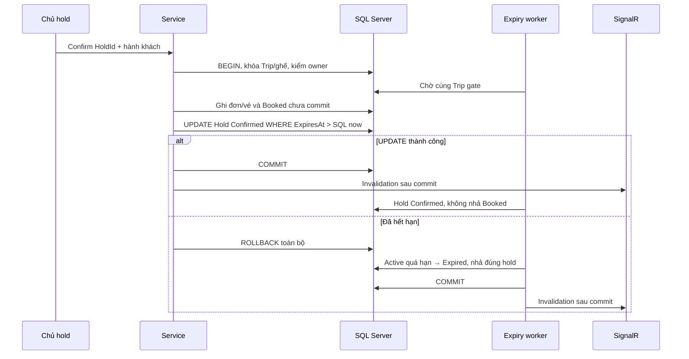

# Sequence: hai người tranh cùng ghế

```mermaid
sequenceDiagram
    participant A as Khách A
    participant S as BookingService
    participant DB as SQL Server
    participant B as Khách B
    participant R as SignalR
    A->>S: Hold ghế X, key A
    S->>DB: BEGIN, UPDLOCK Trip và ghế X
    B->>S: Hold ghế X, key B
    S->>DB: B chờ trip gate ngắn
    S->>DB: A ghi Held + Expires, COMMIT
    S-->>A: Hold A và hạn
    S->>R: Invalidation revision sau commit A
    DB-->>S: B nhận gate; X đã Held còn hạn
    S->>DB: B ROLLBACK
    S-->>B: 409, tải lại snapshot
```

## Confirm và expiry



Đổi: khóa Trip cũ/mới theo ID tăng dần → kiểm yêu cầu, owner hold mới và hạn → vô hiệu vé cũ/nhả ghế → insert vé mới/Booked → conditional UPDATE hạn cuối → commit một lần → phát cho cả hai nhóm. Lỗi ở bất cứ bước nào rollback cả hai phía.
